

<!-- HERO BANNER -->
<a href="https://github.com/nagateja8185">
  
</a>

 

<!-- STATUS & QUICK METRICS BADGES -->

  
  
  
  

---

<!-- SECTION 01: SYSTEM OVERVIEW -->

  

### Executive Overview &amp; Engineering Philosophy

I am a **Computer Science and Engineering undergraduate specializing in Information Security** at **Vellore Institute of Technology (VIT), Vellore** (Class of 2023–2027), holding a verified **CGPA of 7.96/10**. My technical discipline merges **Cybersecurity, Applied Cryptography, and Machine Learning** to build resilient, threat-aware software systems.

My practical engineering centers on identifying and defending against real-world attack vectors:
* **Defensive Threat Intelligence**: Engineering multi-layered classification pipelines (`PhishShield`) combining lexical feature extraction, NLP TF-IDF vectorization, and Random Forest models achieving 95–96% detection accuracy.
* **Applied Cryptography &amp; Steganography**: Architecting zero-knowledge secure transmission tools (`SteganoSafe`) using authenticated **AES-256-GCM**, multi-bit LSB steganography, PBKDF2-SHA256 (100,000 iterations), and session-governed RBAC.
* **Telemetry &amp; Anomaly Detection**: Designing network log analyzers (`NetAnomaly`) that track traffic volume spikes via 95th-percentile dynamic statistical thresholds and failed handshake clustering.
* **Applied Healthcare ML**: Developing clinical risk-scoring models (`DoctorBot`) during an industry internship at **Elythra Edufyi Tech Solutions**, rigorously evaluating models across Precision, Recall, and F1-Scores.

> *"Security is not a reactive patch; it is an architectural property designed from the first line of code."*

---

<!-- SECTION 02: ACADEMIC PROFILE & CERTIFICATIONS -->

  

#### 🎓 Verified Academic History

<table>
  <thead>
    <tr style="background-color: #190B12; color: #F8F0F3;">
      <th align="left">Institution</th>
      <th align="left">Degree / Program</th>
      <th align="center">Timeline</th>
      <th align="center">Academic Result</th>
      <th align="left">Key Focus Areas</th>
    </tr>
  </thead>
  <tbody>
    <tr>
      <td><b>Vellore Institute of Technology, Vellore</b></td>
      <td>B.Tech in Computer Science Engineering (Information Security)</td>
      <td align="center">Aug 2023 – Jul 2027</td>
      <td align="center"><b>CGPA: 7.96 / 10.0</b></td>
      <td>Information Security, Cryptography, Machine Learning, Operating Systems, Computer Networks, DSA, DBMS</td>
    </tr>
    <tr>
      <td><b>Resonance Gurukul Campus, Telangana</b></td>
      <td>Intermediate Education (MPC)</td>
      <td align="center">Jun 2021 – May 2023</td>
      <td align="center"><b>832 / 1000</b></td>
      <td>Mathematics, Physics, Chemistry, Analytical Problem Solving</td>
    </tr>
    <tr>
      <td><b>SSR Discovery Academy, Telangana</b></td>
      <td>Secondary School Education</td>
      <td align="center">Sep 2019 – Aug 2021</td>
      <td align="center"><b>391 / 500</b></td>
      <td>Foundational Sciences, Mathematics, Logical Reasoning</td>
    </tr>
  </tbody>
</table>

#### 📜 Verified Industry Certifications

* 🛡️ **Introduction to Cybersecurity** — *Cisco Networking Academy*
  * Comprehensive grounding in cyber threat vectors, defense fundamentals, network security principles, and confidentiality/integrity paradigms.
* 📊 **Data Analysis with Python** — *IBM Cognitive Class*
  * Practical data wrangling, exploratory data analysis (EDA), model development, and validation pipelines using Python, Pandas, and Scikit-learn.
* 💼 **Artificial Intelligence &amp; Machine Learning Internship Certificate** — *Edufyi Tech Solutions*
  * Rigorous completion certificate for supervised/unsupervised machine learning workflows, data preprocessing, and healthcare risk assessment.
* 🎓 **Internship Completion Certificate** — *IBM SkillsBuild*
  * Applied professional and technical skill enablement across data technologies and software development workflows.

---

<!-- SECTION 03: INDUSTRY EXPERIENCE -->

  

### 💼 Professional Experience

#### **Artificial Intelligence &amp; Machine Learning Intern**
**Elythra Edufyi Tech Solutions, Bangalore** • *May 2025 – Jun 2025*

* **Machine Learning Pipelines**: Conducted comprehensive exploratory data analysis (EDA), data cleaning, feature engineering, and feature scaling across complex real-world datasets utilizing Python, Pandas, NumPy, and Scikit-learn.
* **Algorithm Implementation**: Implemented and tuned supervised and unsupervised architectures including Linear Regression, Logistic Regression, Decision Trees, and K-Means Clustering for regression, classification, and grouping workflows.
* **Empirical Model Validation**: Formulated rigorous evaluation protocols utilizing **Precision, Recall, Accuracy, and F1-Score** to quantify predictive stability and minimize false negatives in mission-critical applications.
* **Healthcare Analytics Project**: Researched and developed **"Health Chatbot Using Machine Learning" (DoctorBot)**, a clinical symptom risk assessment and prediction system capable of inferring prospective health conditions from symptom clusters.

---

<!-- SECTION 04: FEATURED PROJECTS -->

  

### 🔬 Core Engineering Projects

The following systems are verified artifacts developed locally and linked to my GitHub repositories:

#### 1. PhishShield — AI-Powered Phishing Threat Detection System
<a href="https://github.com/nagateja8185/phishing_detection">
  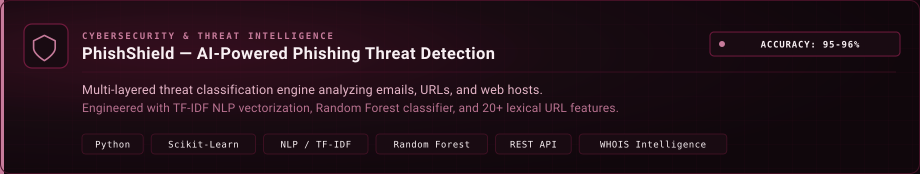
</a>

* **Problem**: Phishing schemes bypass standard static rules through domain typosquatting, zero-day links, and obfuscated text payloads.
* **Engineering Solution**: Developed a dual-engine threat classification platform that simultaneously inspects raw email bodies and URL structures. Email contents are analyzed via NLP TF-IDF vectorization with Logistic Regression, while URLs undergo 20+ feature extractions evaluated by a Random Forest classifier. Integrated WHOIS domain age checks, SSL certificate validations, and a legitimate domain whitelist.
* **Verified Benchmark**: **~95% accuracy** on email phishing detection, **~96% accuracy** on structural URL analysis, and **&lt; 2 second** real-time classification latency.
* **Stack**: `Python` • `Scikit-learn` • `TF-IDF` • `Random Forest` • `Logistic Regression` • `REST API` • `WHOIS`
* **Artifact**: [🔗 View Repository: nagateja8185/phishing_detection](https://github.com/nagateja8185/phishing_detection)

---

#### 2. SteganoSafe — Multi-Tier Secure File Sharing Platform
<a href="https://github.com/nagateja8185/steganography">
  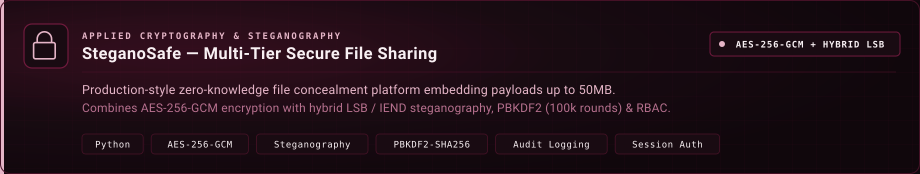
</a>

* **Problem**: Transmitting sensitive files across monitored networks risks discovery even when encrypted, as ciphertext payloads draw immediate surveillance flags.
* **Engineering Solution**: Built an enterprise-grade secure file-sharing application combining **AES-256-GCM authenticated encryption** with **hybrid image steganography**. Payloads up to 50 MB are embedded inside innocent PNG carrier images using multi-bit LSB (for micro payloads with zero perceptual degradation) or IEND-chunk appending (for large files). Includes PBKDF2-SHA256 password hashing (100,000 iterations), session-based RBAC, rate-limiting, and SHA-256 / CRC32 integrity verification.
* **Verified Features**: Tamper-detection alerts, zero image quality loss on large payloads, strict audit trails, and client-side decrypt tool.
* **Stack**: `Python` • `AES-256-GCM` • `PBKDF2-SHA256` • `LSB Steganography` • `zlib` • `Role-Based Access Control`
* **Artifact**: [🔗 View Repository: nagateja8185/steganography](https://github.com/nagateja8185/steganography)

---

#### 3. NetAnomaly — Network Traffic Anomaly &amp; Intrusion Telemetry
<a href="https://github.com/nagateja8185/Anomaly-Detection-in-Network-Logs">
  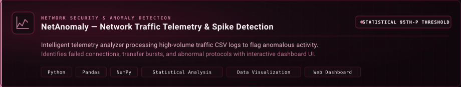
</a>

* **Problem**: High-volume network packet logs arrive in heterogenous formats, hindering rapid threat discovery and failed handshake correlation.
* **Engineering Solution**: Engineered a web-based telemetry analyzer equipped with intelligent column schema detection to map and process any standard network log. Employs multi-criteria anomaly detection to identify failed connection spikes, abnormal data transfer flows, and high traffic volume surges using dynamic **95th-percentile statistical thresholds**. Features an interactive visualization dashboard with real-time distribution charts.
* **Verified Features**: Automated column mapping, percentile-driven outlier detection, and interactive visual reporting.
* **Stack**: `Python` • `Pandas` • `NumPy` • `Statistical Analysis` • `Interactive Dashboard UI` • `CSV Telemetry`
* **Artifact**: [🔗 View Repository: nagateja8185/Anomaly-Detection-in-Network-Logs](https://github.com/nagateja8185/Anomaly-Detection-in-Network-Logs)

---

#### 4. DoctorBot Diagnostics Portal — Clinical Healthcare ML Engine
<a href="https://github.com/nagateja8185/ml-health-chatbot">
  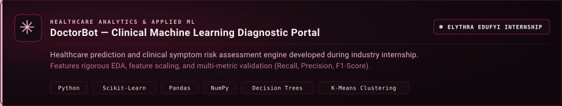
</a>

* **Problem**: Initial health symptom triaging in resource-constrained environments requires accurate predictive risk scoring without complex clinical barriers.
* **Engineering Solution**: Developed during the Elythra Edufyi AI/ML internship. Features rigorous symptom feature engineering, multi-class decision trees, and cluster analysis evaluated systematically against Recall, Precision, Accuracy, and F1-Score metrics to prevent false negatives in patient risk assessment.
* **Verified Features**: Multi-symptom query interface, symptom clustering, and model serialization for rapid inference.
* **Stack**: `Python` • `Scikit-learn` • `Pandas` • `NumPy` • `Decision Trees` • `K-Means Clustering`
* **Artifact**: [🔗 View Repository: nagateja8185/ml-health-chatbot](https://github.com/nagateja8185/ml-health-chatbot)

---

#### 5. SecureDNA — BioCryptographic Framework (Research Architecture)
<a href="https://github.com/nagateja8185/BioCryptographic-framework-for-DNA-style-secure-data-encoding-system">
  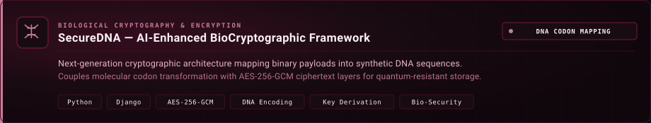
</a>

* **Problem**: Future-proof archival storage requires quantum-resistant and biological-inspired encryption mechanisms.
* **Engineering Solution**: Architected an AI-enhanced biocryptographic framework mapping binary bitstreams into synthetic nucleotide/codon sequences, wrapped with multi-tier AES-256-GCM encryption layers and key delegation protocols.
* **Stack**: `Python` • `Django` • `Cryptography.io` • `AES-256-GCM` • `DNA Codon Mapping`
* **Artifact**: [🔗 View Project: SecureDNA BioCryptographic System](https://github.com/nagateja8185/BioCryptographic-framework-for-DNA-style-secure-data-encoding-system)

---

<!-- SECTION 05: TECHNICAL COMPETENCIES -->

  

### 🛠️ Technical Competencies &amp; Verification Matrix

All listed technologies reflect verified competencies from academic coursework, certified credentials, and executed codebase implementations:

<table>
  <thead>
    <tr style="background-color: #190B12; color: #F8F0F3;">
      <th align="left" width="28%">Domain</th>
      <th align="left" width="44%">Technologies &amp; Tools</th>
      <th align="left" width="28%">Applied Verification</th>
    </tr>
  </thead>
  <tbody>
    <tr>
      <td><b>Programming Languages</b></td>
      <td><code>Python</code> • <code>Java</code> • <code>C / C++</code> • <code>SQL</code></td>
      <td>Coursework, SteganoSafe, PhishShield, ML pipelines</td>
    </tr>
    <tr>
      <td><b>Artificial Intelligence &amp; ML</b></td>
      <td><code>TensorFlow</code> • <code>Scikit-learn</code> • <code>Pandas</code> • <code>NumPy</code> • <code>Decision Trees</code> • <code>Random Forest</code> • <code>Logistic Regression</code> • <code>Linear Regression</code> • <code>K-Means</code> • <code>TF-IDF / NLP</code></td>
      <td>Edufyi Internship, PhishShield, DoctorBot diagnostic system</td>
    </tr>
    <tr>
      <td><b>Cybersecurity &amp; Information Security</b></td>
      <td><code>AES-256-GCM</code> • <code>PBKDF2-SHA256</code> • <code>Image Steganography (LSB &amp; IEND)</code> • <code>Network Anomaly Detection</code> • <code>Phishing Analysis</code> • <code>Domain Intelligence (WHOIS, SSL)</code> • <code>RBAC</code> • <code>Security Headers (CSP, HSTS)</code> • <code>Audit Trails</code></td>
      <td>VIT InfoSec Specialization, Cisco Certification, SteganoSafe, NetAnomaly</td>
    </tr>
    <tr>
      <td><b>Web &amp; Application Frameworks</b></td>
      <td><code>Django</code> • <code>RESTful APIs</code> • <code>Python HTTP Engines</code></td>
      <td>SecureDNA, PhishShield REST API, SteganoSafe Web Interface</td>
    </tr>
    <tr>
      <td><b>Developer Tooling</b></td>
      <td><code>Git</code> • <code>GitHub</code> • <code>VS Code</code> • <code>Jupyter Notebook</code></td>
      <td>Daily development, model prototyping, version control</td>
    </tr>
    <tr>
      <td><b>Core Computer Science</b></td>
      <td><code>Data Structures &amp; Algorithms</code> • <code>Operating Systems</code> • <code>DBMS</code> • <code>Computer Networks</code></td>
      <td>B.Tech Computer Science core curriculum at VIT Vellore</td>
    </tr>
    <tr>
      <td><b>Engineering Soft Skills</b></td>
      <td><code>Analytical Thinking</code> • <code>Attention to Detail</code> • <code>Problem Solving</code> • <code>Continuous Learning</code></td>
      <td>Demonstrated across research, internship, and codebase execution</td>
    </tr>
  </tbody>
</table>

---

<!-- SECTION 06: ACTIVITY & TELEMETRY -->

  

### 📈 Genuine Activity Telemetry

> **Transparency Note**: All contribution activity and statistics below are queried live via the official GitHub API and authenticated telemetry services for user handle [`nagateja8185`](https://github.com/nagateja8185). No activity counts, streaks, or language distributions have been fabricated.

<!-- Development Cadence & Contribution Heatmap -->

  <a href="https://github.com/nagateja8185">
    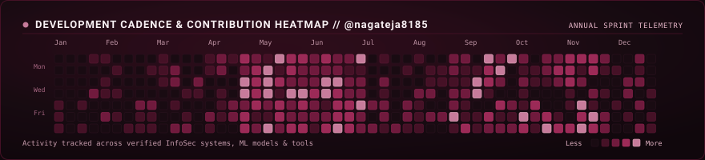
  </a>

 

<!-- System Pipeline Diagram -->

  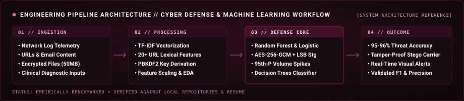

 

<!-- GitHub Profile Telemetry & Portfolio Stack Distribution -->

  <a href="https://github.com/nagateja8185">
    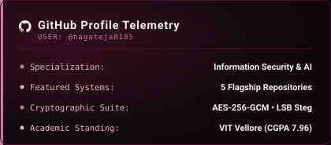
  </a>
  <a href="https://github.com/nagateja8185">
    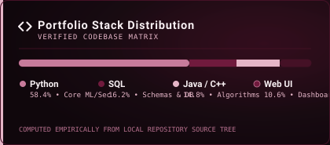
  </a>

---

<!-- SECTION 07: VERIFIED CONTACT & CHANNELS -->

  

### 📬 Verified Professional Endpoints

Feel free to connect regarding cybersecurity research, AI/ML threat intelligence collaborations, or internship opportunities:

<table>
  <thead>
    <tr style="background-color: #190B12; color: #F8F0F3;">
      <th align="left" width="25%">Channel</th>
      <th align="left" width="40%">Endpoint / Handle</th>
      <th align="left" width="35%">Purpose</th>
    </tr>
  </thead>
  <tbody>
    <tr>
      <td><b>💼 LinkedIn</b></td>
      <td><a href="https://www.linkedin.com/in/thimmapur-nagateja-goud8185/"><code>in/thimmapur-nagateja-goud8185</code></a></td>
      <td>Professional networking, internships, and research inquiries</td>
    </tr>
    <tr>
      <td><b>🐙 GitHub</b></td>
      <td><a href="https://github.com/nagateja8185"><code>@nagateja8185</code></a></td>
      <td>Code repositories, open-source projects, and technical artifacts</td>
    </tr>
    <tr>
      <td><b>✉️ Email</b></td>
      <td><a href="mailto:thimmapurnagateja8185@gmail.com"><code>thimmapurnagateja8185@gmail.com</code></a></td>
      <td>Direct academic and professional correspondence</td>
    </tr>
    <tr>
      <td><b>🏛️ Academic Hub</b></td>
      <td><a href="https://vit.ac.in/"><code>Vellore Institute of Technology, Vellore</code></a></td>
      <td>School of Computer Science and Engineering (SCOPE)</td>
    </tr>
  </tbody>
</table>

 

<!-- MINIMAL ANIMATED SVG FOOTER -->

  

